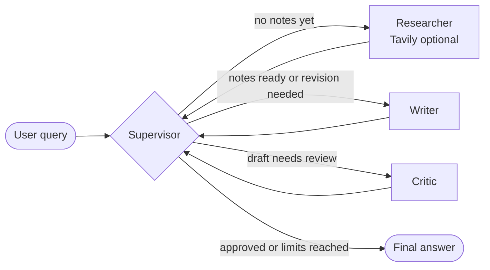
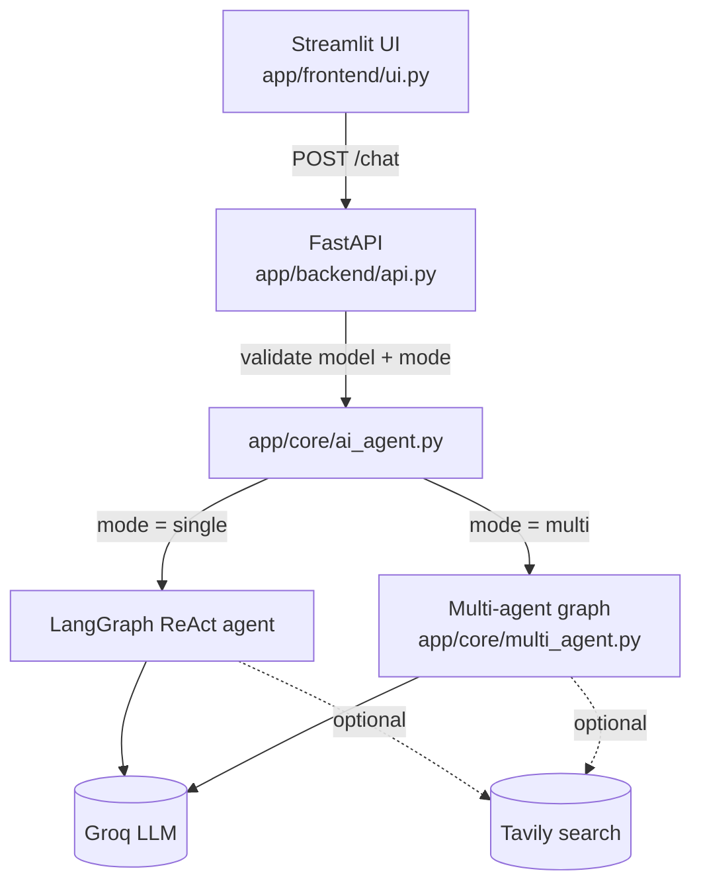

<div align="center">

# 🤖 MULTI AI Agent System

**A configurable LLM assistant that runs as a single ReAct agent or as a supervisor-led team of specialist agents.**


</div>

---

## ✨ Overview

**MULTI AI Agent System** is a small, readable web application for asking questions to an LLM-backed assistant. You define how the assistant should behave, pick a Groq-hosted model, optionally enable live web search (Tavily), and choose how the answer is produced:

| Mode | What runs | Best for |
|---|---|---|
| 🟢 **Single agent** | One LangGraph ReAct agent, with Tavily search if enabled | Quick questions, lowest latency and cost |
| 🔵 **Multi-agent** | A LangGraph `StateGraph` with a **supervisor, researcher, writer and critic** sharing state | Questions where research, drafting and review should be separate steps |

The project is intentionally compact, so you can read every file and understand exactly how an agent workflow is wired from the UI to the model.

---

## 🧠 Multi-Agent Architecture



| Agent | Responsibility |
|---|---|
| **Supervisor** | Decides the next step: `researcher`, `writer`, `critic` or `FINISH`. Deterministic guards run first; the LLM chooses only when no guard applies. |
| **Researcher** | Gathers concise notes. Uses a ReAct agent with Tavily search when web search is enabled; otherwise answers from model knowledge and says so. |
| **Writer** | Drafts the user-facing answer from the query, your agent definition and the research notes, and applies critic feedback on revisions. |
| **Critic** | Reviews the draft for correctness, completeness and unsupported claims. Returns `APPROVE` or concrete revision feedback. |

### 🛑 Stop conditions

The graph is bounded so it can never loop forever:

- `max_iterations` (default **6**) caps supervisor decisions.
- `max_revisions` (default **2**) caps critic-to-writer revision cycles.
- A critic `APPROVE` ends the run.
- An invalid or unparseable supervisor route falls back to `FINISH`.

### 📦 Shared state

Nodes communicate through one typed state object (`MultiAgentState`): `messages`, `research_notes`, `draft`, `critique`, `next`, `iteration_count`, `revision_count`, `agent_trace`, `user_query`, `system_prompt`, `allow_search`, `max_iterations`, `max_revisions`. The `agent_trace` field records which agents ran and in what order, which makes runs easy to debug and test.

---

## 🏗️ System Architecture



**Request flow**

1. `python app/main.py` starts the FastAPI backend (Uvicorn, port `9999`), then launches Streamlit.
2. The UI sends `model_name`, `system_prompt`, `message`, `allow_search` and `mode`.
3. FastAPI rejects unknown models and modes with HTTP `400`.
4. `get_response_from_ai_agents` runs the single-agent or multi-agent path.
5. The final clean AI message is returned as JSON and rendered in the browser.

---

## 🚀 Getting Started

### Prerequisites

- Python **3.10+**
- A [Groq](https://console.groq.com/) API key
- A [Tavily](https://tavily.com/) API key *(only if you want web search)*

### Install

```bash
git clone https://github.com/ABHISHEKKHOPADE/MULTI-AI-AGENT-SYSTEM.git
cd MULTI-AI-AGENT-SYSTEM

python -m venv .venv
source .venv/bin/activate        # Windows: .venv\Scripts\activate

pip install -e .
```

### Configure

Create a `.env` file in the project root (never commit it):

```env
GROQ_API_KEY=your_groq_key
TAVILY_API_KEY=your_tavily_key   # required only when web search is enabled
```

### Run

```bash
python app/main.py
```

| Service | URL |
|---|---|
| FastAPI backend | `http://127.0.0.1:9999` (interactive docs at `/docs`) |
| Streamlit UI | `http://localhost:8501` |

### Using the UI

1. *(Optional)* Define your agent's behaviour in the system prompt box.
2. Select a Groq model.
3. Tick **Allow web search** if you want live results.
4. Choose **Single agent** or **Multi-agent**.
5. Enter your query and click **Ask Agent**.

---

## 🔌 API

### `POST /chat`

```json
{
  "model_name": "llama-3.1-8b-instant",
  "system_prompt": "You are a helpful assistant.",
  "message": "Explain LangGraph.",
  "allow_search": false,
  "mode": "multi"
}
```

| Field | Type | Notes |
|---|---|---|
| `model_name` | string | Must be in the allowed model list in `app/config/settings.py` |
| `system_prompt` | string | Agent definition; may be empty |
| `message` | string | The user query |
| `allow_search` | boolean | Enables Tavily web search |
| `mode` | string | `"single"` (default) or `"multi"` |

**Response**

```json
{ "response": "…final answer text…" }
```

Unknown `model_name` or `mode` values return **HTTP 400**.

```bash
curl -X POST http://127.0.0.1:9999/chat \
  -H "Content-Type: application/json" \
  -d '{"model_name":"llama-3.1-8b-instant","system_prompt":"","message":"Explain LangGraph.","allow_search":false,"mode":"multi"}'
```

---

## 🗂️ Project Structure

```text
MULTI-AI-AGENT-SYSTEM/
├── app/
│   ├── main.py                  # Starts backend (Uvicorn) then Streamlit
│   ├── backend/
│   │   └── api.py               # FastAPI app, POST /chat, request validation
│   ├── core/
│   │   ├── ai_agent.py          # Single-agent ReAct path + mode dispatch
│   │   └── multi_agent.py       # Supervisor / researcher / writer / critic graph
│   ├── frontend/
│   │   └── ui.py                # Streamlit interface
│   ├── config/
│   │   └── settings.py          # Allowed models, environment config
│   └── common/
│       ├── logger.py            # Central logging
│       └── custom_exception.py  # Consistent exception messages
├── tests/                       # Offline tests using fake LLMs
├── Dockerfile
├── Jenkinsfile
├── requirements.txt
└── setup.py
```

---

## 🧪 Testing

The tests run **offline**: they replace the LLM with a fake object, so no API keys or network are needed. They verify:

- the supervisor routes in the expected order (`researcher → writer → critic → FINISH`),
- `max_iterations` stops a looping supervisor,
- the critic-to-writer revision loop is capped,
- single mode still uses the original ReAct path.

```bash
pip install pytest
python -m compileall app
pytest
```

> Offline tests prove the orchestration logic. They do not prove answer quality from a live model, so run a manual smoke test with real keys as well.

---

## 🐳 Docker

```bash
docker build -t multi-ai-agent .
docker run --rm -p 8501:8501 --env-file .env multi-ai-agent
```

Pass secrets at run time with `--env-file`; do not bake them into the image. Keep `.env` out of the build context with a `.dockerignore`.

## 🔁 CI/CD

The `Jenkinsfile` defines a pipeline that checks out the repository and runs **SonarQube** static analysis. Stages for building and pushing an image to **Amazon ECR** and redeploying to **ECS Fargate** are included as commented reference blocks; enable and review them (region, repository, image tag, credentials) before use.

---

## ⚖️ Design Trade-offs

- **More agents, more cost.** A successful multi-agent run makes about six LLM calls (three routing decisions plus researcher, writer and critic) versus one in single mode, so latency and token use are higher. Use single mode for simple questions.
- **Bounded by design.** Deterministic guards run before the routing LLM, so a misbehaving model cannot create an endless loop.
- **Search is optional.** Live search adds freshness but also cost, latency and a dependency on Tavily.

## ⚠️ Known Limitations

- Prototype scope: no authentication, rate limiting or persistent conversation memory.
- Supervisor routing relies on LLM output parsing; structured output would be more robust.
- The critic's `APPROVE` is matched as an exact string.
- Errors from the AI layer are returned as response text rather than as HTTP error codes.
- The frontend's backend URL (`127.0.0.1:9999`) is hardcoded, and startup waits a fixed delay instead of a health check.
- Web search results are passed into prompts unfiltered, so prompt-injection from web content is a known risk.

## 🛣️ Roadmap

- [ ] Structured (Pydantic) routing output and critic verdicts
- [ ] `/health` endpoint and readiness check instead of a startup delay
- [ ] Request timeouts, retries and proper HTTP error codes
- [ ] Persistent session memory
- [ ] Authentication and rate limiting
- [ ] Answer-quality evaluation and citation checks
- [ ] Enabled build/push/deploy stages in CI/CD

---

## 👤 Author

**Abhishek Khopade**: AI & Data Science undergraduate focused on applied AI, agentic systems and MLOps.
[GitHub](https://github.com/ABHISHEKKHOPADE)

<div align="center">

⭐ If you found this project useful, consider giving it a star.

</div>
